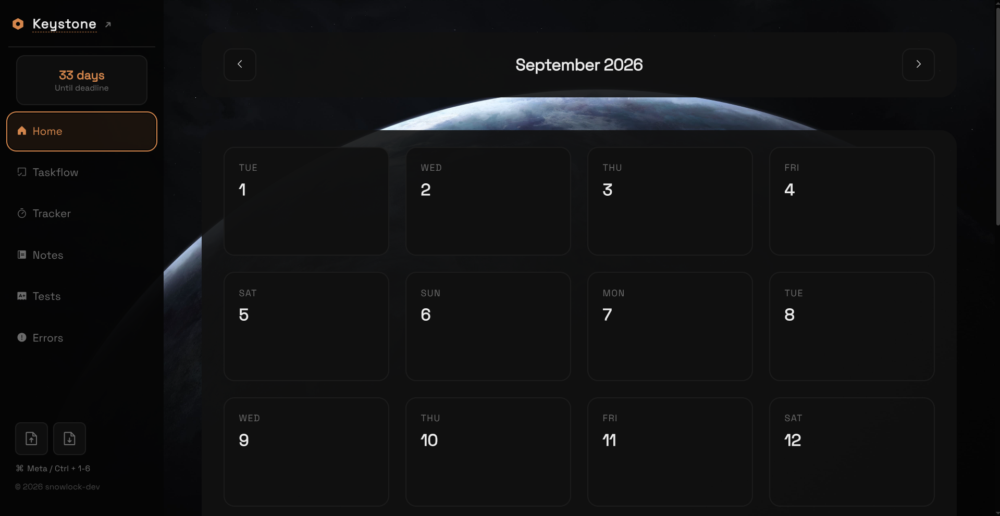

# keystone

Keystone is my attempt at a private, local-first workspace website.

It tries to combine all of the features I love from different productivity
apps and websites, while also allowing easy backups and a seamless experience.

It was built with a focus on fast performance, crash-safe data handling, 
and keyboard-driven workflows, bringing together task management, time 
tracking, notes, and analytics into one unified website.

> [!NOTE]
> ABOUT AI USAGE:
>
> A lot of code was AI-assisted and generated.
> I have done my best to test them out, but I cannot
> guarentee a bug-free experience.

> [!IMPORTANT]
>
> Since Keystone is made to fill my own needs, feature 
> updates break older backups. If you want to use this project
> I highly recommend making a fork
> (backward compatibility for legacy data isn't guarenteed!)

## Usage

1. Using the web version: [Keystone](https://keystone-snowlock.web.app)
2. Locally: CLone the repo and start a http server (`python -m http.server 8000`). 
Then visit it on any browser (`localhost:8000`)

## Keyboard Shortcuts
1. `Ctrl/Cmd + K`: Opens Global Search
2. `Ctrl/Cmd + 1–6`: Jumping between sections
3. `←-/-→`: Moving through months in calendar & days in taskflow
4. `/`: Focuses the task input in TaskFlow
5. `Esc`: Closes modals or kicks you out of Zen Mode

## Architecture
It's all vanilla JS and completely local-first using `localStorage`:

- *Crash-Safe Atomic Writes:* To make sure that no data gets lost by crashes and such, keystone 
writes to a `_tmp` key first, validates it, and only then swaps it in.

- *Transactional State:* A `Storage.transaction()` method that clones the state, modifies it, 
validates it, and atomically commits it. If the data is invalid, it just gets rejected.

- *Cross-Tab Sync:* It uses `storage` events to keep tabs in sync, and background tabs pause their 
note-saving to prevent overwrites.

- *Normalization & Migration:* It automatically cleans up malformed data, generates missing 
IDs, and migrates any of the older, legacy data.

- *Storage Limit Awareness:* It tracks the actual byte size using `TextEncoder` and warns you when 
you start getting close to that 5MB limit.

## Credits

* `assets/wallpaper.jpg`(Default Wallpaper) from: [Wallhaven](https://wallhaven.cc/w/nm6o2k)

* `assets/ph-fill` / `assets/ph-regular`: [Phosphor Icons](https://phosphoricons.com/)
